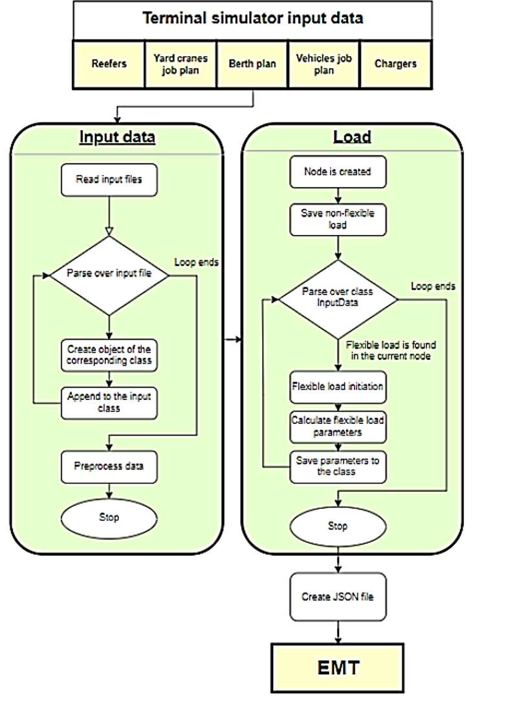

# Load Flexibility Tool

This project is a simple computational tool for computing load flexibility parameters based on the specific characteristics of various port assets, namely onshore power supplies (OPS), electric vehicles (e-vehicles), yard cranes, and reefer containers. In its current version, the computational framework primarily acts as an interface between the Terminal Simulator (SM4) and the Energy Matching Tool (DS2). It uses input data from the Terminal Simulator and processes and configures this data to generate the inputs required by the Energy Matching Tool (EMT). However, the underlying mathematical models are more general in scope, allowing the computational framework to be readily reused and adapted to different operational contexts. For further details about the tool's structure and underlying mathematical models, users can refer to the accompanying technical document in this repository.

---


### Project Status

This project is currently in **maintenance** mode, with no further feature development planned. Changes to the underlying Terminal Simulator structure mean that the current implementation may no longer be directly applicable. However, the underlying computational framework and mathematical models may serve as a useful foundation for future projects or further developments, should the need arise.


### Technology Stack  
  
- **Python** – Core programming language.
- **Pandas** – Data manipulation and processing.
- **Python Standard Library:**
  - `datetime` – Date and time handling.
  - `collections` – Data structures, including `defaultdict`.
  - `os` – Operating system and file-system interactions.
  - `json` – JSON data handling.
  - `random` – Random number generation.
  - `math` – Mathematical operations.

## Installation
 
 Clone the repository
 ```shell
 git clone https://github.com/MAGPIE-WP4-Digital-Tools/Terminal_Assets_Flexibility.git
 cd Terminal_Assets_Flexibility

## Usage
Execute the `main.py` script from the project's root directory to run the simulation:

```bash
python main.py
```


## Output Files

Once the simulation completes, check the `data/` directory for the testcase_results.json file:


## Architecture Diagrams

### Software Architecture



---

## Contacts


* Zenaida Mourão (zenaida.mourao@inesctec.pt)
* Tiago Soares (tiago.a.soares@inesctec.pt)
* Adrian Carrillo Galvez (adrian.c.galvez@.inesctec.pt)
* Ilia Ponomarev (ilia.ponomarev@inesctec.pt)


